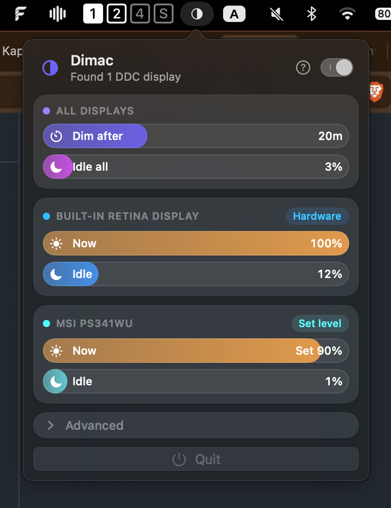

# Dimac

Dimac is a macOS menu bar app for Apple Silicon MacBooks that lowers internal and external display brightness after inactivity, helping reduce how long static images stay at full intensity and lowering burn-in or ghosting risk. When activity resumes, it restores the previous brightness.

## Screenshots

<p align="center">
  
  
</p>

## What It Does

- Dims built-in and external displays after an idle timeout to reduce the impact of long unchanged images.
- Restores previous brightness when mouse, keyboard, or scroll activity resumes.
- Stores per-display dim levels and runs as a menu bar app without a Dock icon.
- Captures actual brightness before each dim cycle; saved settings never define the restore level.
- Leaves screens that are already darker than the dim target at their current brightness.

If an external monitor is unplugged while dimmed, Dimac keeps its previous brightness in the recovery snapshot, including across app restarts. After activity resumes, reconnecting that monitor retries its restoration automatically; temporary command failures also retry every five seconds. Other displays can continue their normal dim/wake cycles while recovery is pending. Recovery uses the monitor UUID reported by `m1ddc` when available, otherwise a unique display name; ambiguous matches remain pending rather than changing another monitor.

Set the timeout and dim level to get started. Each display has its own idle level. Changes apply on the next idle cycle. Use its “Current” slider to adjust a screen’s current brightness from Dimac. It reads the live value and applies your choice when you release the slider. “Idle” sets the next idle target; current brightness is never saved as a restore preference. If a monitor cannot report brightness, manual adjustment remains available and “Set N%” shows its last known normal level. A successful manual setting enables idle dimming for that monitor during this app session, using that level for restoration when reading is unavailable. UUID-identified monitors retain this level across disconnects, and restoring a recovery snapshot reestablishes it even after an app restart. A restart without a recovery snapshot requires setting it again. Invalid helper readings are rejected. Changes through monitor buttons cannot be detected without readable brightness.

## Requirements

- Tested on Apple Silicon MacBooks (M-series) running macOS 13 or newer
- `m1ddc` for DDC-capable external displays
- `brightness` for built-in display control and hardware discovery

Dimac does not bundle either helper. It looks for executables on disk and lets you override both paths in `Advanced` settings.

## Quick Start

1. Install the helper tools:

```sh
brew install m1ddc

git clone https://github.com/nriley/brightness.git
cd brightness
make
sudo make install
```

2. Build the app:

```sh
zsh ./scripts/build-app.sh
```

3. Open `.build/release/Dimac.app`.

See [INSTALL.md](INSTALL.md) for full install notes and helper details.

## Notes

- Input Monitoring is optional. If already granted, brightness can restore a bit faster.
- Dimac does not send activity data anywhere.
- Full privacy details are in [PRIVACY.md](PRIVACY.md).

## Brightness diagnostics

The diagnostic build records local JSON-line logs in `~/Library/Logs/Dimac/diagnostics.jsonl`, with two rotated files (`.1` and `.2`, newest first), up to about 15 MB total. Log writes remove entries five hours old or older from all three files, including after relaunch or waking from sleep. While the app is closed or the Mac is asleep, cleanup waits until logging resumes. Size rotation can retain less than five hours. Keep all three after reproducing a problem. Each entry includes a timestamp, process/session ID, and sequence number. Startup records identify the exact running bundle/build and other Dimac instances.

The trace includes idle observations (every ten seconds and on wake activity), sleep/wake and display notifications, display identities, UI requested/reported levels, effective dim settings, original/applied/pending snapshots, restore decisions, and helper commands with raw output, exit status, and duration. It records activity transitions without recording keystrokes or mouse positions. Logs stay on this Mac. No logging failure is allowed to stop brightness recovery.

To reproduce: quit the old app, replace it with the diagnostic bundle, launch it, set **Current** to 70% and **Idle** to 1%, wait for dimming, unplug the monitor, wait past the timeout, wake the Mac, reconnect, then exercise a second dim/wake cycle. Note the approximate time when the values become wrong and leave the log files in place for inspection. The stale-readback emulation covers a helper reporting 1 after an accepted restore to 70; this is diagnostic coverage, not proof that the physical monitor has that fault.

## Contributing

Start with [CONTRIBUTING.md](CONTRIBUTING.md), [SECURITY.md](SECURITY.md), and [CODE_OF_CONDUCT.md](CODE_OF_CONDUCT.md).

## License

Dimac is available under the [MIT License](LICENSE).

Run regression tests with `zsh scripts/test.sh` using full Xcode. On a Command Line Tools-only Mac, `python3 scripts/test-clt.py` executes the synchronous test scenarios with a lightweight assertion runner against the built app and core. It does not replace XCTest lifecycle or hardware testing.
