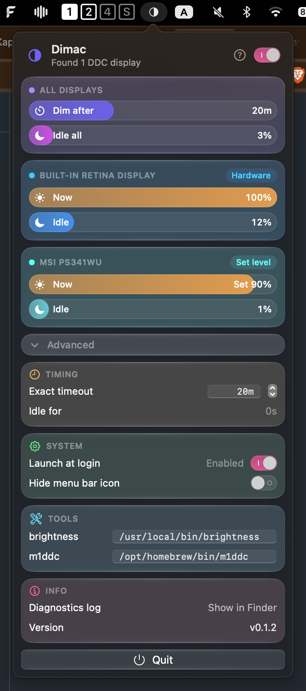

# Dimac

Dimac is a macOS menu bar app for Apple Silicon MacBooks that lowers internal and external display brightness after inactivity, helping reduce how long static images stay at full intensity and lowering burn-in or ghosting risk. When activity resumes, it restores the previous brightness.

## Screenshots

<p align="center">
  
</p>

## What It Does

- Dims built-in and external displays after an idle timeout to reduce the impact of long unchanged images.
- Restores previous brightness when mouse, keyboard, or scroll activity resumes.
- Stores per-display dim levels and runs as a menu bar app without a Dock icon.
- Captures actual brightness before each dim cycle; saved settings never define the restore level.
- Leaves screens that are already darker than the dim target at their current brightness.

Set the timeout and dim level to get started. Advanced settings allow a different dim level for each display. Changes apply on the next idle cycle. The former “Bright” setting is no longer needed; use macOS or your monitor controls to choose your working brightness.

## Requirements

- Tested on Apple Silicon MacBooks (M-series) running macOS 13 or newer
- `m1ddc` for DDC-capable external displays
- `brightness` for built-in display control and hardware discovery

Dimac does not bundle either helper. It looks for executables on disk and lets you override both paths in `Advanced` settings.

## Quick Start

1. Install the helper tools:

```sh
brew install m1ddc

git clone https://github.com/nriley/brightness.git
cd brightness
make
sudo make install
```

2. Build the app:

```sh
zsh ./scripts/build-app.sh
```

3. Open `.build/release/Dimac.app`.

See [INSTALL.md](INSTALL.md) for full install notes and helper details.

## Notes

- Input Monitoring is optional. If already granted, brightness can restore a bit faster.
- Dimac does not send activity data anywhere.
- Full privacy details are in [PRIVACY.md](PRIVACY.md).

## Contributing

Start with [CONTRIBUTING.md](CONTRIBUTING.md), [SECURITY.md](SECURITY.md), and [CODE_OF_CONDUCT.md](CODE_OF_CONDUCT.md).

## License

Dimac is available under the [MIT License](LICENSE).
